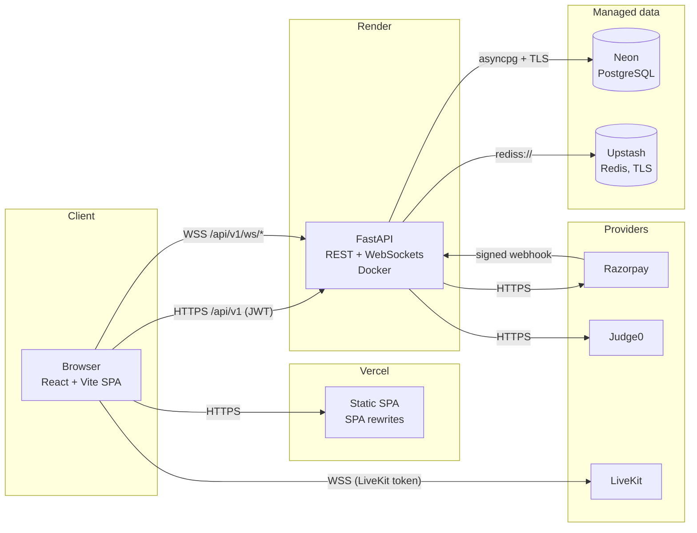

# Profexia

**Profexia** is a full-stack learning platform that connects learners with teachers. Teachers publish courses and assessments, run live learning sessions, and learners discover courses, enroll, track their progress, take tests, chat in real time, and run code in the browser.

[](https://github.com/nithinprasad0/profexia/actions/workflows/ci.yml)

---

## Problem statement

Independent teachers and small institutes usually juggle several disconnected tools: a website for course listings, a form for sign-ups, a video-call app for live classes, a separate quiz tool, a chat group, and a payment link. Learners lose track of what they enrolled in and how far they have progressed, and teachers have no single view of their learners.

Profexia brings these pieces into one platform with a single account, role-based access, and a consistent API so that course discovery, enrollment, assessment, live sessions, real-time messaging, code execution, and payments work together.

## Main features

| Area | Features |
| --- | --- |
| Authentication | Registration, login, JWT access tokens, rotating refresh tokens (Redis), logout, `/users/me` |
| Learning | Course catalogue and search, skill filtering, teacher discovery, course details, enrollment, progress tracking, teacher course creation/editing |
| Assessment | Question bank, tests, timed attempts, automatic scoring, results for learners and teachers |
| Real-time | WebSocket chat rooms, live notifications, learning-session signalling |
| External providers | Razorpay payment orders + signed webhooks, Judge0 code execution, LiveKit video-room tokens |
| Platform | Health/readiness endpoints, Alembic migrations, Docker, CI, Vercel + Render deployment configs |
| Security | Server-side role and membership checks, Redis rate limiting, single-use refresh tokens, Redis pub/sub WebSocket fan-out for multiple instances (see [SECURITY.md](SECURITY.md)) |

## User roles

| Role | Can do |
| --- | --- |
| **Learner** | Browse courses and teachers, enroll, update progress, take tests, view own results, join sessions of enrolled courses, chat, run code |
| **Teacher** | Everything public, plus create/edit own courses, questions and tests, host learning sessions, view results for own tests |
| **Admin** | Manage skills, send notifications, access all sessions/results. Admins **cannot** self-register — see [Creating an admin](docs/BACKEND.md#creating-an-admin) |

All permissions are enforced by the backend; the frontend only hides UI that a role cannot use.

## Technology stack

| Layer | Technology |
| --- | --- |
| Backend | Python 3.12, FastAPI, SQLAlchemy 2 (async, asyncpg), Alembic, Pydantic v2, PyJWT, bcrypt, WebSockets |
| Data | PostgreSQL 17, Redis 8 |
| Frontend | React 19, TypeScript, Vite 7, React Router 7 |
| External | Razorpay, Judge0, LiveKit |
| Tooling | Docker, Docker Compose, GitHub Actions, pytest |
| Hosting (target) | Vercel (frontend), Render (API), Neon (PostgreSQL), Upstash (Redis) |

## Architecture



More detail: [docs/ARCHITECTURE.md](docs/ARCHITECTURE.md).

## Project structure

```text
profexia/
├── app/                        # FastAPI backend
│   ├── api/v1/                 # Routers: auth, users, learning, assessment, realtime, providers
│   ├── core/                   # Settings, database engine, Redis, security (JWT, bcrypt)
│   ├── domain/models.py        # SQLAlchemy models
│   ├── infrastructure/         # WebSocket manager, provider clients, seed + admin scripts
│   ├── schemas/                # Pydantic request/response models
│   └── main.py                 # App factory: CORS, lifespan, health endpoints
├── alembic/                    # Migration environment + versions (0001 … 0005)
├── tests/                      # pytest suite (no external services required)
├── scripts/smoke_test.py       # End-to-end test against a running API
├── frontend/                   # React + TypeScript + Vite SPA
│   ├── src/api/                # API client, endpoint config, WebSocket client
│   ├── src/auth/               # AuthProvider (tokens, refresh, session)
│   ├── src/pages/ src/routes/  # Pages and route guards
│   └── vercel.json             # Vercel build + SPA rewrites
├── docs/                       # Architecture, API, deployment, env reference, phase notes
├── .github/workflows/ci.yml    # CI: tests, migrations, smoke test, typecheck, build, docker
├── Dockerfile                  # Backend image (used by Render and docker-compose)
├── docker-entrypoint.sh        # Migrations → role seed → uvicorn on $PORT
├── docker-compose.yml          # Local Postgres + Redis + API
├── render.yaml                 # Render Blueprint
├── .env.example                # Backend environment template
└── requirements.txt
```

## Installation

Prerequisites: Docker Desktop (or Docker Engine + Compose), Node.js 22+, Git. Python 3.12 is only needed to run the backend outside Docker.

```bash
git clone https://github.com/nithinprasad0/profexia.git
cd profexia
```

## Local development

### 1. Backend (Docker Compose)

```bash
docker compose up -d --build
```

This starts PostgreSQL, Redis and the API. On start the API container applies migrations (`alembic upgrade head`) and seeds the `learner`/`teacher`/`admin` roles. Data lives in the named volumes `postgres_data` and `redis_data`, which survive restarts and rebuilds. **Do not** run `docker compose down -v` unless you intend to wipe local data.

- API: http://localhost:8000
- Interactive docs: http://localhost:8000/docs
- Health: http://localhost:8000/health

Run the tests inside the container:

```bash
docker compose exec api pytest -q
```

### 2. Frontend (Vite)

```bash
cd frontend
cp .env.example .env      # Windows PowerShell: Copy-Item .env.example .env
npm install
npm run dev
```

Open http://localhost:5173. The dev server talks to `http://localhost:8000` by default.

### 3. Without Docker (optional)

```bash
python -m venv .venv && source .venv/bin/activate   # Windows: .venv\Scripts\activate
pip install -r requirements.txt
cp .env.example .env    # point DATABASE_URL / REDIS_URL at your local services
alembic upgrade head
python -m app.infrastructure.seed
uvicorn app.main:app --reload
```

More: [docs/BACKEND.md](docs/BACKEND.md), [frontend/README.md](frontend/README.md).

## Environment configuration

| File | Purpose |
| --- | --- |
| [`.env.example`](.env.example) | Backend variables (database, Redis, JWT, CORS, rate limits, real-time, providers) — copy to `.env` for local runs |
| [`frontend/.env.example`](frontend/.env.example) | `VITE_API_URL` (and optional `VITE_WS_URL`) — copy to `frontend/.env` |
| [`docker-compose.yml`](docker-compose.yml) | Working local defaults; no `.env` needed for Docker development |
| [`render.yaml`](render.yaml) | Production backend settings; secrets are entered in Render, never committed |

Full reference with defaults: [docs/ENVIRONMENT.md](docs/ENVIRONMENT.md). Real `.env` files are git-ignored; `.env.example` files contain placeholders only.

## API documentation

- Live OpenAPI/Swagger UI: `/docs`, ReDoc: `/redoc`, schema: `/openapi.json`
- Endpoint reference: [docs/API.md](docs/API.md)

## Deployment architecture

| Component | Provider | Config |
| --- | --- | --- |
| Frontend | Vercel (root directory `frontend`) | [`frontend/vercel.json`](frontend/vercel.json) |
| Backend | Render web service (Docker) | [`render.yaml`](render.yaml), [`Dockerfile`](Dockerfile) |
| PostgreSQL | Neon | `DATABASE_URL` |
| Redis | Upstash (TLS) | `REDIS_URL` (`rediss://…`) |
| CI | GitHub Actions: backend tests + migrations + smoke, frontend typecheck/build, secret scan, dependency audits, Docker build | [`.github/workflows/ci.yml`](.github/workflows/ci.yml) |

Step-by-step guide, costs and limitations: **[docs/DEPLOYMENT.md](docs/DEPLOYMENT.md)**. Every environment variable: [docs/ENVIRONMENT.md](docs/ENVIRONMENT.md). Security model, role permissions and known risks: **[SECURITY.md](SECURITY.md)**.

## Screenshots

> Add screenshots to `docs/screenshots/` and update the paths below.

| Screen | Preview |
| --- | --- |
| Login | `docs/screenshots/login.png` |
| Registration | `docs/screenshots/register.png` |
| Learning hub (learner) | `docs/screenshots/learning-hub.png` |
| Teacher workspace | `docs/screenshots/teacher-workspace.png` |
| Course details | `docs/screenshots/course-detail.png` |

## Roadmap

- [ ] Frontend UI for assessments (tests, attempts, results)
- [ ] Frontend UI for chat, notifications and live sessions (APIs and WebSocket client already exist)
- [ ] LiveKit video room UI and room-name binding to learning sessions
- [ ] Razorpay checkout flow for paid courses (order + webhook APIs exist)
- [ ] Code playground UI backed by Judge0
- [ ] Move tokens from `sessionStorage` to HttpOnly cookies
- [ ] Email verification and password reset
- [ ] Course content (lessons, media) and certificates

## Contributing

1. Create a branch, make changes, and run `pytest -q`, `npm run typecheck` and `npm run build`.
2. Open a pull request — CI must pass before merging.

## License

No license has been chosen yet. Until one is added, all rights are reserved by the author. Add a `LICENSE` file (for example MIT) before accepting outside contributions.
