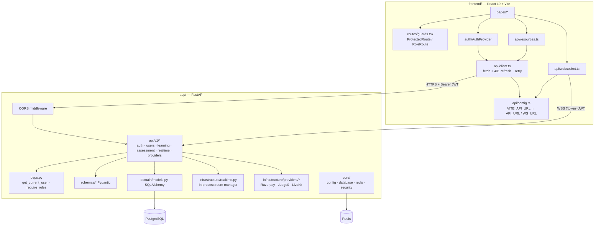
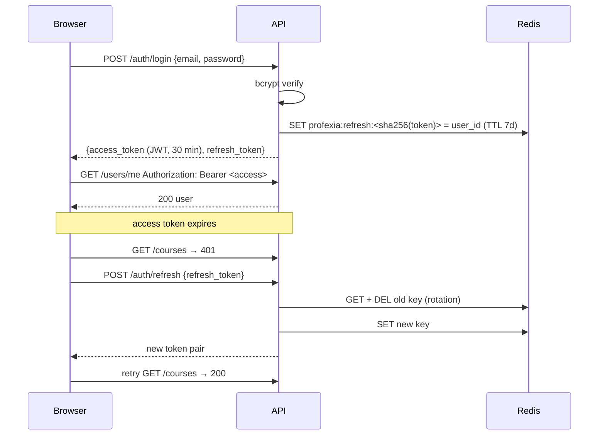
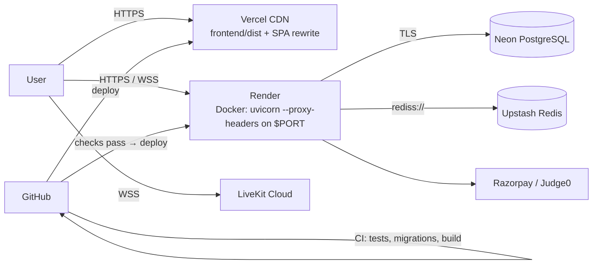

# Architecture

## Overview

Profexia is a single-page React application talking to a FastAPI backend over a versioned REST API (`/api/v1`) and WebSockets (`/api/v1/ws/*`). PostgreSQL is the system of record; Redis stores short-lived authentication state. Third-party providers handle payments (Razorpay), sandboxed code execution (Judge0) and real-time video (LiveKit).

## Backend layers

| Layer | Location | Responsibility |
| --- | --- | --- |
| HTTP/WebSocket | `app/api/v1/` | Routing, request validation, authorization checks |
| Schemas | `app/schemas/` | Pydantic request/response contracts |
| Domain | `app/domain/models.py` | SQLAlchemy 2 models (users, roles, profiles, skills, courses, enrollments, questions, tests, submissions, chat, notifications, learning sessions, payments, code executions, LiveKit audit) |
| Infrastructure | `app/infrastructure/` | WebSocket connection manager, provider HTTP clients, seed/admin scripts |
| Core | `app/core/` | Settings (env), async engine + sessions, Redis client, password hashing, JWT |
| Migrations | `alembic/versions/` | `0001_core_domain` → `0002_learning_progress` → `0003_assessment` → `0004_realtime` → `0005_external_providers` (head) |

## Authentication flow

- Passwords: bcrypt with per-password salt.
- Access tokens: HS256 JWT with `sub`, `role`, `type=access`, `iat`, `exp`.
- Refresh tokens: 384-bit random strings; only their SHA-256 hash is stored in Redis; single use (atomic `GETDEL` on every refresh); deleted on logout.
- Login, registration, refresh and code execution are rate limited in Redis (429 + `Retry-After`).
- WebSockets authenticate with `?token=<access token>` and close with code 1008 when invalid.
- Roles are checked server-side through `require_roles(...)` and per-resource ownership checks.
- Public registration may choose `learner` or `teacher`; `admin` is rejected (403) and must be granted with `python -m app.infrastructure.create_admin`.

## Frontend

- `api/config.ts` resolves `VITE_API_URL` (with or without `/api/v1`) to one canonical base and derives `ws://`/`wss://` from it. Production builds never fall back to `localhost`.
- `api/client.ts` attaches the bearer token, refreshes once on 401 (de-duplicated across concurrent requests) and retries the original request.
- Tokens are kept in `sessionStorage` (per tab, cleared when the tab closes).
- `routes/guards.tsx` redirects unauthenticated users to `/login` and non-teachers away from `/app/teach`; the API enforces the same rules independently.

## Deployment topology

Startup sequence on Render (`docker-entrypoint.sh`): `alembic upgrade head` → idempotent role seed → `uvicorn app.main:app --host 0.0.0.0 --port $PORT --proxy-headers`. The FastAPI lifespan validates production settings, logs redacted connection info, and disposes the DB engine on shutdown.

## Known architectural limits

- Each instance keeps its own WebSocket connections in memory; events are shared across instances through Redis pub/sub (`app/infrastructure/realtime.py`). Delivery is at-most-once.
- Authorization helpers shared by REST and WebSocket endpoints live in `app/api/v1/access.py`; rate limiting in `app/core/rate_limit.py`. See [SECURITY.md](../SECURITY.md).
